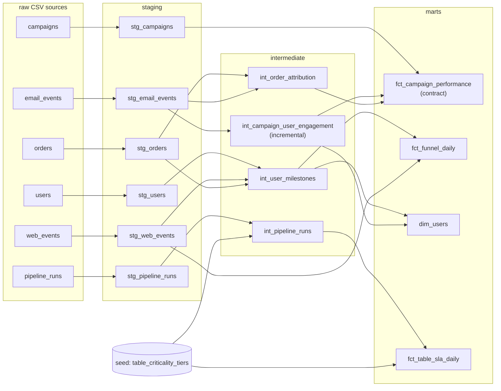

# marketing-data-reliability

A dbt project that models a marketing lifecycle (registration → email
engagement → first key action → first order) **and** monitors whether each
table met its SLA. It runs locally on DuckDB, so you need no cloud account.
The SQL is warehouse-style and ports to Snowflake with minor dialect changes.

All data is synthetic, generated by `scripts/generate_data.py`. The generator
plants the problems real event pipelines have: duplicate deliveries,
late-arriving rows, casing drift and orders that change after the fact.

## What it shows

| Area | Where |
|---|---|
| Layered modeling: staging → intermediate → marts | `models/` |
| Deduplication of re-delivered events and versioned rows | `stg_email_events`, `stg_web_events`, `stg_orders` |
| Incremental model with a late-data strategy and a lookback window | `int_campaign_user_engagement` |
| Last-click attribution, done once at order grain | `int_order_attribution` |
| Cohort funnel that flags immature cohorts | `fct_funnel_daily` |
| Enforced model contract (names, types, PK) | `fct_campaign_performance` |
| Generic, custom generic and singular tests (91 nodes in `dbt build`) | `models/**/_*.yml`, `tests/` |
| SLA tiers as a seed, plus daily freshness/uptime/runtime scoring | `seeds/table_criticality_tiers.csv`, `fct_table_sla_daily` |
| A test that catches seconds-vs-minutes unit bugs | `tests/assert_run_duration_units_consistent.sql` |
| Proof that incremental output equals a full rebuild | `scripts/check_incremental_parity.sh` (runs in CI) |

## Lineage



## How to run

Requires Python 3.10+.

```bash
python -m venv .venv && source .venv/bin/activate
pip install dbt-duckdb            # or: pip install -r requirements.txt
python scripts/generate_data.py   # writes data/raw/*.csv
dbt build                         # seeds, models and tests (profiles.yml is in the repo)
```

To watch the incremental model absorb late data:

```bash
python scripts/generate_data.py --late-batch   # appends late opens/clicks + duplicates
dbt build                                      # incremental run picks them up
./scripts/check_incremental_parity.sh          # compares to a full rebuild: 0 rows differ
./scripts/check_incremental_parity.sh 0        # same with the lookback disabled: 40 rows differ
```

To explore results, run `dbt docs generate && dbt docs serve`, or open
`data/warehouse.duckdb` in any DuckDB client. Tables live in schemas
`staging`, `intermediate`, `marts` and `reference`.

## Design choices

### Fact grains

- **`fct_campaign_performance`**: one row per campaign, lifetime to date.
  Engagement counts **users**, not events. A user who opens three times is one
  unique open, so open rate can't exceed 100% and the funnel stays monotonic
  (`tests/assert_email_funnel_is_monotonic.sql`).
- **`fct_funnel_daily`**: one row per **registration cohort date × signup
  channel**. The funnel is cohort-based (registered on day D; did they act
  within 7 days; did they order within 30) rather than event-date-based, so
  rates on different days are comparable. Cohorts younger than the conversion
  window get `is_cohort_complete = false`, so a dashboard doesn't read
  "hasn't happened yet" as "conversion dropped".
- **`int_campaign_user_engagement`**: one row per campaign × user. This grain is
  small enough to rebuild per key and rich enough to feed both the campaign
  mart and `dim_users`.
- **`int_order_attribution`**: one row per order. Attribution is resolved once,
  at order grain, with exactly one winning click per order. A reconciliation
  test (`assert_attributed_revenue_reconciles.sql`) checks that campaign
  revenue sums to the same total, which catches double counting when an order
  matches several clicks.

### Incremental strategy and late data

`int_campaign_user_engagement` uses `delete+insert` on a surrogate key
(`campaign_id|user_id`) with a **"recompute affected keys"** pattern:

1. Read the high-water mark: the newest `_loaded_at` already in the table.
2. Select every key with **any** event loaded after
   `high-water mark − late_data_lookback_hours` (default 24h).
3. Rebuild those keys from **all** of their events, not just the new ones.

The filter is on **load time, not event time**. A filter like
`event_at > max(event_at)` is the classic way incremental models silently drop
late data: an open from last Tuesday that lands today is older than the mark,
so it is never read. Filtering on `_loaded_at` picks it up however old the
event is. Rebuilding the whole key keeps derived fields right, such as
`first_open_at` and unique-open flags.

The **lookback** handles a subtler case: a slow or parallel loader that
commits rows with a `_loaded_at` slightly *behind* the current mark. The
generator's `--late-batch` plants 40 of these on purpose. With the 24h
lookback, the incremental result matches a full rebuild exactly. With the
lookback set to 0, those 40 rows are wrong. Both runs are shown above, and CI
runs the parity check on every push.

Trade-off: a wider lookback re-processes more keys each run. Here, a run
with no new data re-processes 2 of ~18,450 keys. A real deployment would size
the lookback from observed loader skew.

Duplicates are removed in staging (`qualify row_number() ... = 1` on the
natural key), so re-processing a key twice is idempotent.

### Reliability layer and the units bug

`seeds/table_criticality_tiers.csv` gives each monitored table a tier, an
owner, a refresh cadence and three targets: freshness, max runtime and daily
uptime. `fct_table_sla_daily` scores every table × day against them, with
these rules:

- **Freshness** is the worst staleness that day: the longest gap between
  consecutive successful loads, or between the last success and end of day.
- **Uptime** is successful runs / attempted runs.
- **Runtime** is the slowest successful run.
- **Full-day outages** still produce a row and fail, because the model starts
  from a date spine.

The synthetic orchestrator log includes a few incidents, such as a 7-hour
failure streak on `fct_funnel_daily` and a day of 6× slower runs on
`stg_web_events`, so the mart has misses to show.

**The bug it guards against.** The orchestrator reports `duration_seconds`.
Every SLA target is in minutes. If someone compares the two directly, or
drops the `/ 60` in `int_pipeline_runs`, a normal 12-minute run reads as 720
"minutes". Every tier-1 table then breaches its runtime SLA, and the on-call
person learns to ignore the alerts. The opposite mistake (dividing twice) is
worse: real breaches look 60× smaller and pass silently. Two tests guard
against this:

- `assert_run_duration_units_consistent.sql` re-derives each run's duration
  from its start/finish timestamps and fails if it disagrees with
  `duration_minutes`. I checked it by injecting the bug: **all 7,230 runs
  fail**.
- A `within_range` test on `duration_minutes` (0–720) is a cheap backstop. With
  the same bug it flags only the ~1,000 runs longer than 12 minutes. It is
  useful but not enough on its own, which is why the reconciliation test
  exists.

The seed has its own range tests too. A `freshness_target_minutes` of 7200
for a "2 hour" target means someone typed seconds into a minutes column.

### Other notes

- Sources read the CSVs directly through dbt-duckdb's `external_location`, with
  every column as text. Staging owns all casting and normalization.
- `generate_schema_name` is overridden so each layer gets a clean schema name.
- The tests need no packages (no `dbt deps`). Range checks and
  multi-column uniqueness use two small custom generic tests in
  `tests/generic/`.

## Project layout

```
scripts/generate_data.py             synthetic data (stdlib only, deterministic)
scripts/check_incremental_parity.sh  incremental vs full-refresh check
seeds/table_criticality_tiers.csv    SLA tiers and targets
models/staging/                      rename, cast, dedupe (views)
models/intermediate/                 engagement (incremental), attribution, milestones, run timings
models/marts/marketing/              fct_campaign_performance, fct_funnel_daily, dim_users
models/marts/reliability/            fct_table_sla_daily
tests/                               singular tests + custom generic tests
```
